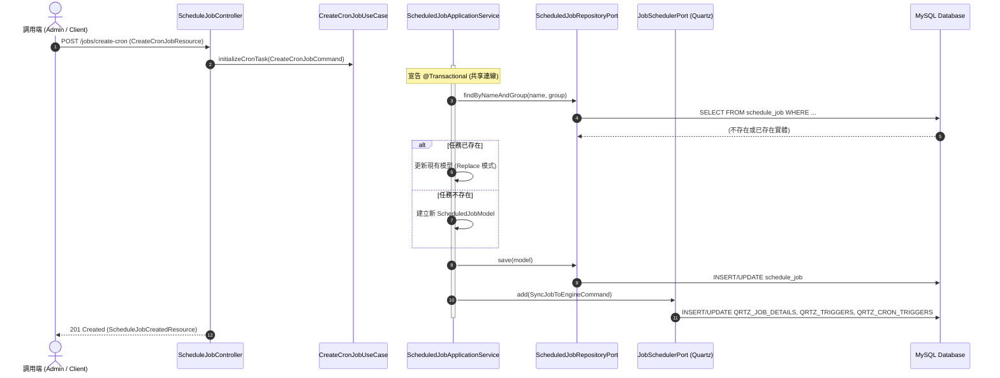
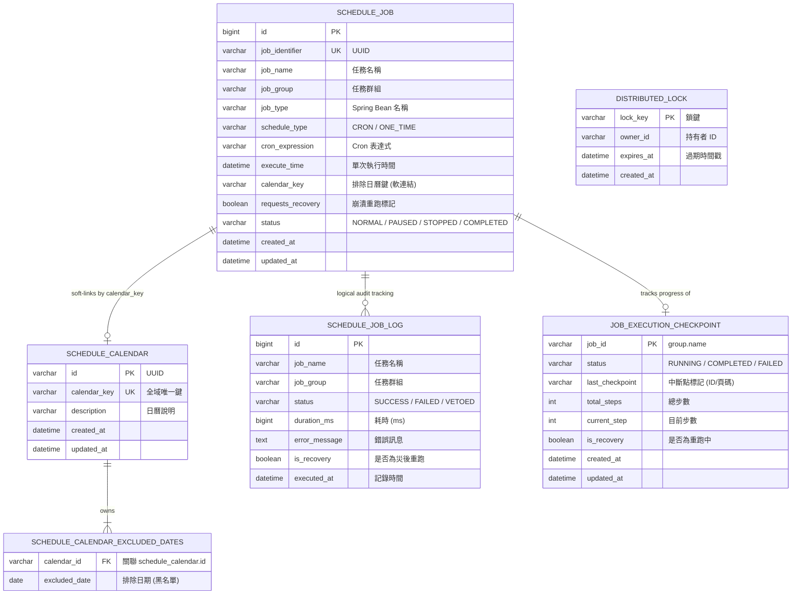

# 系統設計規格書 (System Design Specification)
## 分散式排程任務管理模組 (Schedules Management Module)

---

## 1. 系統概述 (System Overview)

### 1.1 系統定位與目標
`schedules-management-module` 定位為**高可用、強一致性之嵌入式技術基礎設施模組 (Embedded Technical Infrastructure Module)**。本模組旨在作為未來企業級微服務系統的統一排程基底，提供：
- **動態排程生命週期管理**：支援定時排程 (Cron) 與一次性排程 (OneTime) 的即時註冊、修改、暫停、恢復與刪除。
- **排程日曆例外過濾**：全域共享日曆黑名單（排除國定假日、特定例假日）。
- **分散式叢集高可用 (HA)**：多節點叢集自動競爭執行權，防範任務重複執行，支援節點宕機自動故障轉移 (Failover)。
- **長時批次斷點續跑**：透過 Checkpoint 機制支援大批量任務在宕機後精確接續執行。
- **事務強一致性**：業務表與 Quartz 引擎表共享資料庫連線，異動具備 ACID 原子性保證。

### 1.2 系統架構風格
系統全面採用 **六角形架構 (Hexagonal / Clean Architecture)**：
- **表現層 (Presentation Layer / Inbound Adapters)**：REST Controller 與 Quartz Job 類別。
- **應用層 (Application Layer)**：細粒度 Inbound Port UseCases (`V + N + UseCase`)、Outbound Ports (`...Port`)、純資料模型與 VO。
- **基礎設施層 (Infrastructure Layer / Outbound Adapters)**：`infra/persistence/`（JPA Entity 與 Repository）與 `infra/adapter/`（適配器）。

---

## 2. 總體架構與資料流向 (Architecture & Data Flow)

### 2.1 分層架構圖
```
+-----------------------------------------------------------------------------------+
|                        Presentation Layer (Inbound Adapters)                      |
|  - ScheduleJobController, CalendarController                                      |
|  - Inbound Quartz Jobs: BatchSendEmailJob, FailoverSimulationJob, etc.            |
+------------------------------------------+----------------------------------------+
                                           | 調用 UseCases
                                           v
+-----------------------------------------------------------------------------------+
|                                 Application Layer                                 |
|  [port/in/]                                                                       |
|    - CreateCronJobUseCase, CreateOneTimeJobUseCase, UpdateScheduleJobUseCase      |
|    - BindJobCalendarUseCase, PauseScheduleJobUseCase, ResumeScheduleJobUseCase    |
|    - CompleteScheduleJobUseCase, GetScheduleJobUseCase                            |
|    - CreateCalendarUseCase, AddExcludedDateUseCase, RemoveExcludedDateUseCase     |
|    - GetCalendarUseCase                                                           |
|  [service/]                                                                       |
|    - ScheduledJobApplicationService, CalendarApplicationService                   |
|  [shared/]                                                                        |
|    - VO: JobId, JobStatus, ScheduleType, CronExpression, ScheduleRule            |
|    - Model: ScheduledJobModel, ScheduleCalendarModel                             |
|  [port/out/]                                                                      |
|    - ScheduledJobRepositoryPort, ScheduleCalendarRepositoryPort                   |
|    - JobSchedulerPort, CronParserPort, DistributeLockManagerPort                  |
+------------------------------------------+----------------------------------------+
                                           ^ 實作 Outbound Port
                                           |
+-----------------------------------------------------------------------------------+
|                      Infrastructure Layer (Outbound Adapters)                     |
|  [adapter/]                                                                       |
|    - ScheduledJobRepositoryAdapter, ScheduleCalendarRepositoryAdapter             |
|    - JobSchedulerAdapter (對接 Quartz 引擎), CronParserAdapter                    |
|  [persistence/] (JPA Repositories & Entities)                                     |
|    - schedule_job, schedule_calendar, schedule_job_log,                          |
|      job_execution_checkpoint, distributed_lock                                   |
|  [quartz/]                                                                        |
|    - Quartz Clustered Scheduler (QRTZ_* 表)                                       |
+-----------------------------------------------------------------------------------+
```

### 2.2 核心排程建立流程時序 (Sequence Diagram)


---

## 3. 資料庫實體關聯圖 (Entity-Relationship Diagram)

系統包含兩大類別資料表：
1. **業務排程資料表 (Business Tables)**：負責業務端配置、例外日曆、稽核日誌與續跑檢查點。
2. **Quartz 系統核心資料表 (Quartz Tables)**：負責底層叢集競爭、觸發器狀態與分佈式行鎖。



---

## 4. 業務資料表結構詳細規格 (Business Table Schema)

### 4.1 排程任務主表 (`schedule_job`)
- **說明**：存放排程任務的業務定義、規則配置與運作狀態。
- **唯一約束**：`UK_JOB_NAME_GROUP (job_name, job_group)`、`UK_JOB_IDENTIFIER (job_identifier)`。

| 欄位名稱 (Column) | 資料型別 (Data Type) | 允許空值 | 預設值 | 鍵值 | 說明 (Description) |
| :--- | :--- | :---: | :---: | :---: | :--- |
| `id` | `BIGINT` | NO | AUTO_INCREMENT | **PK** | 主鍵流水號 |
| `job_identifier` | `VARCHAR(36)` | NO | - | **UK** | 業務唯一識別碼 (UUID) |
| `job_name` | `VARCHAR(100)` | NO | - | **UK_1** | 任務名稱（與 group 構成唯一識別） |
| `job_group` | `VARCHAR(100)` | NO | - | **UK_1** | 任務所屬業務群組 |
| `job_type` | `VARCHAR(100)` | NO | - | - | 技術標籤，對應 Spring 託管的 Job Bean Name |
| `schedule_type` | `VARCHAR(20)` | NO | - | - | 排程類型：`CRON` 或 `ONE_TIME` |
| `cron_expression` | `VARCHAR(100)` | YES | NULL | - | 6 位 Cron 表達式（若為 CRON 任務時必填） |
| `execute_time` | `DATETIME(6)` | YES | NULL | - | 單次執行時間（若為 ONE_TIME 任務時必填） |
| `calendar_key` | `VARCHAR(100)` | YES | NULL | - | 軟連結至 `schedule_calendar.calendar_key` |
| `requests_recovery` | `TINYINT(1)` | NO | 0 | - | 節點崩潰後是否允許其他節點接續執行 |
| `status` | `VARCHAR(20)` | NO | - | - | 業務狀態：`NORMAL`, `PAUSED`, `STOPPED`, `COMPLETED` |
| `created_at` | `DATETIME(6)` | YES | NULL | - | 建立時間 (JPA Auditing) |
| `updated_at` | `DATETIME(6)` | YES | NULL | - | 最後異動時間 (JPA Auditing) |

---

### 4.2 排程例外日曆主表 (`schedule_calendar`)
- **說明**：存放日曆基本資訊。
- **唯一約束**：`UK_CALENDAR_KEY (calendar_key)`。

| 欄位名稱 (Column) | 資料型別 (Data Type) | 允許空值 | 預設值 | 鍵值 | 說明 (Description) |
| :--- | :--- | :---: | :---: | :---: | :--- |
| `id` | `VARCHAR(36)` | NO | - | **PK** | 日曆 UUID |
| `calendar_key` | `VARCHAR(100)` | NO | - | **UK** | 日曆全域識別鍵（對應 Quartz CalendarName） |
| `description` | `VARCHAR(255)` | YES | NULL | - | 日曆中文或業務備註說明 |
| `created_at` | `DATETIME(6)` | YES | NULL | - | 建立時間 |
| `updated_at` | `DATETIME(6)` | YES | NULL | - | 最後異動時間 |

---

### 4.3 排程日曆排除日期子表 (`schedule_calendar_excluded_dates`)
- **說明**：記錄日曆黑名單內的具體排除日期（JPA `@ElementCollection`）。

| 欄位名稱 (Column) | 資料型別 (Data Type) | 允許空值 | 預設值 | 鍵值 | 說明 (Description) |
| :--- | :--- | :---: | :---: | :---: | :--- |
| `calendar_id` | `VARCHAR(36)` | NO | - | **FK** | 外鍵，參照 `schedule_calendar.id` |
| `excluded_date` | `DATE` | NO | - | - | 排除日期 (格式: YYYY-MM-DD) |

---

### 4.4 排程執行歷史日誌表 (`schedule_job_log`)
- **說明**：記錄每一次排程被 Quartz 觸發執行的結果與耗時（Append-Only Audit Log）。由 `PersistJobLogListener` 於獨立事務 (`REQUIRES_NEW`) 寫入。

| 欄位名稱 (Column) | 資料型別 (Data Type) | 允許空值 | 預設值 | 鍵值 | 說明 (Description) |
| :--- | :--- | :---: | :---: | :---: | :--- |
| `id` | `BIGINT` | NO | AUTO_INCREMENT | **PK** | 主鍵流水號 |
| `job_name` | `VARCHAR(100)` | YES | NULL | - | 任務名稱 |
| `job_group` | `VARCHAR(100)` | YES | NULL | - | 任務群組 |
| `status` | `VARCHAR(20)` | YES | NULL | - | 執行狀態：`SUCCESS`, `FAILED`, `VETOED` |
| `duration_ms` | `BIGINT` | YES | 0 | - | 執行耗時 (毫秒) |
| `error_message` | `TEXT` | YES | NULL | - | 異常堆疊與錯誤訊息 |
| `is_recovery` | `TINYINT(1)` | YES | 0 | - | 是否為災後重試重跑觸發 |
| `executed_at` | `DATETIME(6)` | YES | NULL | - | 執行記錄生成時間戳 |

---

### 4.5 長時批次任務中斷點表 (`job_execution_checkpoint`)
- **說明**：配合 `AbstractRecoverableBatchJob` 實現斷點續跑。每次批次處理成功即更新 `current_step` 與 `last_checkpoint`。

| 欄位名稱 (Column) | 資料型別 (Data Type) | 允許空值 | 預設值 | 鍵值 | 說明 (Description) |
| :--- | :--- | :---: | :---: | :---: | :--- |
| `job_id` | `VARCHAR(100)` | NO | - | **PK** | 任務全域唯一識別碼（通常為 `group.name`） |
| `status` | `VARCHAR(20)` | YES | NULL | - | 批次執行狀態：`RUNNING`, `COMPLETED`, `FAILED` |
| `last_checkpoint` | `VARCHAR(255)` | YES | NULL | - | 業務中斷點識別標記（如最後處理的 User ID） |
| `total_steps` | `INT` | YES | 0 | - | 任務切分之總步數 (批次數) |
| `current_step` | `INT` | YES | 0 | - | 目前已完成的步驟數 |
| `is_recovery` | `TINYINT(1)` | YES | 0 | - | 標記目前是否處於接續重跑狀態中 |
| `created_at` | `DATETIME(6)` | YES | NULL | - | 開始執行時間 |
| `updated_at` | `DATETIME(6)` | YES | NULL | - | 最後更新進度時間 |

---

### 4.6 備用分散式鎖表 (`distributed_lock`)
- **說明**：資料庫層級互斥鎖實體（模組已全面轉由 Quartz 資料庫行鎖控管，本表保留供外部擴充備用）。

| 欄位名稱 (Column) | 資料型別 (Data Type) | 允許空值 | 預設值 | 鍵值 | 說明 (Description) |
| :--- | :--- | :---: | :---: | :---: | :--- |
| `lock_key` | `VARCHAR(100)` | NO | - | **PK** | 鎖鍵識別碼 |
| `owner_id` | `VARCHAR(100)` | NO | - | - | 鎖持有者 (Instance ID / Thread ID) |
| `expires_at` | `DATETIME(6)` | NO | - | - | 鎖過期時間 |
| `created_at` | `DATETIME(6)` | NO | - | - | 取得鎖時間 |

---

## 5. Quartz 引擎系統資料表規格 (Quartz Engine Tables)

模組配置前綴為 `QRTZ_` 的 Quartz 核心表格，以下列出核心表格及其與業務表的連動關係：

| Quartz 表名 | 職責與描述 | 與業務表 (`schedule_*`) 關聯說明 |
| :--- | :--- | :--- |
| `QRTZ_JOB_DETAILS` | 存放 Quartz JobDetail 定義、Job 類別與屬性 | `JOB_NAME` 與 `JOB_GROUP` 映射 `schedule_job.job_name` 與 `job_group` |
| `QRTZ_TRIGGERS` | 存放所有觸發器的共通狀態 (NEXT_FIRE_TIME, STATE) | 觸發器狀態直接反映在 `/jobs/status` API 的引擎狀態欄位 |
| `QRTZ_CRON_TRIGGERS`| 存放 Cron 表達式與時區設定 | `CRON_EXPRESSION` 與 `schedule_job.cron_expression` 保持同步 |
| `QRTZ_SIMPLE_TRIGGERS`| 存放單次或固定間隔執行的 Trigger | 用於 OneTime 排程任務的調度 |
| `QRTZ_CALENDARS` | 存放序列化後的排除日曆物件 (`org.quartz.impl.calendar.HolidayCalendar`) | `CALENDAR_NAME` 對應 `schedule_calendar.calendar_key` |
| `QRTZ_LOCKS` | 實現多節點叢集悲觀鎖 (`TRIGGER_ACCESS`, `STATE_ACCESS`) | 確保同時間僅有單一節點能觸發同一個 Job |
| `QRTZ_SCHEDULER_STATE`| 節點心跳表，每 15 秒回報節點狀態 | 支援容錯偵測，當節點超時未回報時判定 Crash 並發動 Failover |
| `QRTZ_FIRED_TRIGGERS`| 記錄目前正在執行中的 Trigger 狀態 | 用於叢集重啟時清理未正常結束的執行實例 |

---

## 6. 事務強一致性與併發控制設計 (Concurrency & Transaction)

### 6.1 共享資料源 (Shared DataSource)
```
+-------------------------------------------------------------+
|                  Spring PlatformTransactionManager          |
|                               |                             |
|               +---------------+---------------+             |
|               | (Same JDBC Connection)        |             |
|               v                               v             |
|      JPA Repositories                Quartz JobStoreTX      |
|    (`schedule_job` 等業務表)           (`QRTZ_*` 引擎表)       |
+-------------------------------------------------------------+
```
- **原子性保證**：排程管理操作（例如 `POST /jobs/create-cron` 或 `PUT /jobs/{id}/bind-calendar`）在 Spring 應用層均標記 `@Transactional`。
- **異常同步回滾**：若 Quartz 引擎拋出語法解析例外或寫入失敗，JPA 的資料表異動將全數回滾，絕不發生「資料庫有排程但 Quartz 引擎沒註冊」或「Quartz 已註冊但資料庫找不到記錄」的斷層現象。

### 6.2 悲觀行鎖機制 (Pessimistic Locking)
- 配置 `acquireTriggersWithinLock = true`。
- Quartz 透過 `SELECT * FROM QRTZ_LOCKS WHERE SCHED_NAME = ... AND LOCK_NAME = ? FOR UPDATE` 鎖定特定行。
- 只有成功取得行鎖的節點才能獲取 Trigger 執行權，完美解決多實例叢集並行衝突。

---

## 7. 系統介面與 Inbound Port 映射規格 (API & Port Mapping)

| HTTP Method | API Path | Inbound Port (UseCase) | 涉及之資料表 |
| :--- | :--- | :--- | :--- |
| `POST` | `/jobs/create-cron` | `CreateCronJobUseCase` | `schedule_job`, `QRTZ_JOB_DETAILS`, `QRTZ_TRIGGERS`, `QRTZ_CRON_TRIGGERS` |
| `POST` | `/jobs/create-one-time` | `CreateOneTimeJobUseCase` | `schedule_job`, `QRTZ_JOB_DETAILS`, `QRTZ_TRIGGERS`, `QRTZ_SIMPLE_TRIGGERS` |
| `PUT` | `/jobs/{jobId}/update-cron` | `UpdateScheduleJobUseCase` | `schedule_job`, `QRTZ_CRON_TRIGGERS`, `QRTZ_TRIGGERS` |
| `PUT` | `/jobs/{jobId}/update-one-time`| `UpdateScheduleJobUseCase` | `schedule_job`, `QRTZ_SIMPLE_TRIGGERS`, `QRTZ_TRIGGERS` |
| `PUT` | `/jobs/{jobId}/bind-calendar` | `BindJobCalendarUseCase` | `schedule_job`, `QRTZ_TRIGGERS` |
| `POST` | `/jobs/pause/{jobId}` | `PauseScheduleJobUseCase` | `schedule_job`, `QRTZ_TRIGGERS` |
| `POST` | `/jobs/resume/{jobId}` | `ResumeScheduleJobUseCase` | `schedule_job`, `QRTZ_TRIGGERS` |
| `GET` | `/jobs/status` | `GetScheduleJobUseCase` | `schedule_job`, `QRTZ_TRIGGERS` (分頁與條件過濾快照查詢) |
| `POST` | `/api/calendars` | `CreateCalendarUseCase` | `schedule_calendar`, `QRTZ_CALENDARS` |
| `GET` | `/api/calendars` | `GetCalendarUseCase` | `schedule_calendar`, `schedule_calendar_excluded_dates` |
| `GET` | `/api/calendars/{id}/holidays`| `GetCalendarUseCase` | `schedule_calendar_excluded_dates` |
| `POST` | `/api/calendars/{id}/holidays`| `AddExcludedDateUseCase` | `schedule_calendar_excluded_dates`, `QRTZ_CALENDARS` |
| `DELETE` | `/api/calendars/{id}/holidays/{date}`| `RemoveExcludedDateUseCase` | `schedule_calendar_excluded_dates`, `QRTZ_CALENDARS` |
| *(內部呼叫)*| Quartz 執行完畢觸發 | `CompleteScheduleJobUseCase` | `schedule_job` (轉為 COMPLETED) |
| *(內部監聽)*| Quartz 執行週期監控 | `PersistJobLogListener` | `schedule_job_log` (獨立事務寫入) |
